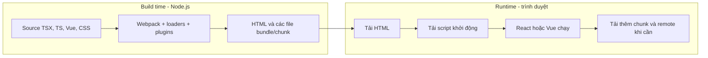
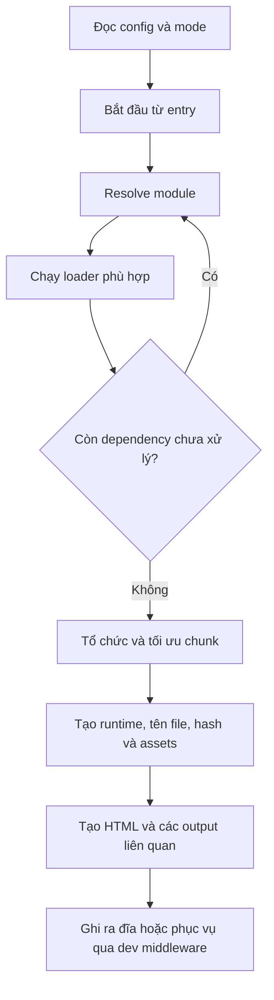
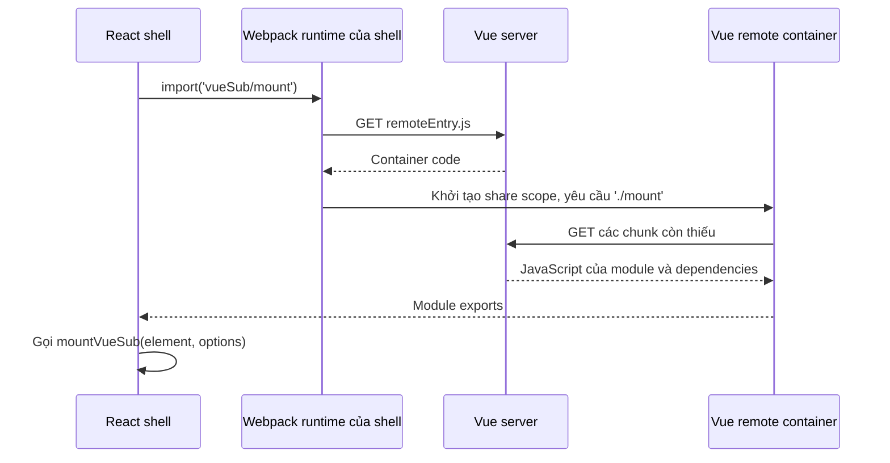

# Webpack: từ source code đến trình duyệt

Webpack không chỉ nối nhiều file JavaScript thành một file lớn. Nó **lần theo các dependency, xử lý từng loại module, tổ chức code thành các chunk và tạo những file để phân phối ứng dụng**.

Tài liệu đi từ một lần mở trang web đến từng cấu hình cụ thể. Các ví dụ chính dựa trên hai ứng dụng trong `~/personal/test-app`:

```text
test-app/
├── shell/                    React host, development ở cổng 5173
│   ├── index.html
│   ├── webpack.config.cjs
│   ├── tsconfig.json
│   ├── package.json
│   └── src/
│       ├── main.tsx
│       ├── bootstrap.tsx
│       ├── remote.ts
│       └── shell/
│           ├── App.tsx
│           └── VueHost.tsx
└── vue-sub/                  Vue remote, development ở cổng 5174
    ├── index.html
    ├── webpack.config.cjs
    ├── tsconfig.json
    ├── package.json
    └── src/
        ├── main.ts
        ├── bootstrap.ts
        ├── mount.ts
        └── CatalogApp.vue
```

Đây là **hai project độc lập**, mỗi project có dependencies và build riêng. Thư mục gốc không có `package.json`. Các giải thích áp dụng cho **Webpack 5**, với `HtmlWebpackPlugin` 5 và các loader đang dùng trong project.

Có thể đọc theo ba lượt:

1. **Nắm cách hoạt động:** phần 1–4 tách build time, browser runtime và các thuật ngữ.
2. **Đọc cấu hình:** phần 5–16 giải thích từng nhóm cấu hình bằng ví dụ cụ thể.
3. **Đối chiếu thực tế:** phần 17–20 lần theo request, xem output và kiểm tra bằng DevTools.

Để đặt Webpack trong bức tranh compiler, bundler và build tool, xem thêm [Frontend build tooling](/web/02-frontend-build-tooling).

## 1. Hai giai đoạn hoàn toàn khác nhau

### 1.1. Build time: Node.js xử lý source

Trong quá trình build, Node.js chạy Webpack và các loader/plugin.

Input có thể chứa những thứ browser chưa chạy được trực tiếp:

```tsx
import { createRoot } from 'react-dom/client';
import { App } from './shell/App';
import './styles.css';

createRoot(document.getElementById('root')!).render(<App />);
```

Đoạn này có:

- Cú pháp TSX như `<App />` và cú pháp TypeScript như dấu `!`.
- Import package bằng tên `react-dom/client`, không phải một URL HTTP.
- Import module nội bộ mà không ghi đuôi `.tsx`.
- Import CSS ngay trong file TypeScript.

Webpack cùng loader biến những input đó thành các file mà trình duyệt có thể sử dụng. Ví dụ minh họa:

```text
shell/dist/
├── index.html
├── main.abc123.js
├── 314.def456.js
└── 327.ghi789.js
```

Các mã hash trong tài liệu là ví dụ rút gọn, trừ những chỗ ghi rõ output thực tế.

### 1.2. Runtime: trình duyệt tải và thực thi output

Sau build, web server phục vụ các file đầu ra. Trình duyệt:

1. Tải HTML.
2. Đọc thẻ `<script>` và tải JavaScript.
3. Thực thi JavaScript để khởi chạy React/Vue.
4. Tải thêm chunk hoặc remote khi code yêu cầu.

**Webpack CLI không chạy trong browser.** Nhưng bundle có thể chứa một đoạn code hỗ trợ do Webpack sinh ra, gọi là **Webpack runtime**. Đoạn code này phụ trách tìm module, ghi nhớ module đã thực thi và tải các chunk còn thiếu.



<Callout type="info" title="Khác nhau giữa tạo file và tải file">

Chunk của một lệnh `import()` thường đã được tạo **trong lúc build**. Khi lệnh đó chạy trong browser, runtime yêu cầu server gửi file đã build; browser không nhờ Webpack CLI biên dịch lại source.

</Callout>

## 2. Module, chunk, asset và entrypoint

Các khái niệm này liên quan nhưng không đồng nghĩa.

| Khái niệm | Cách hiểu đơn giản | Ví dụ |
| --- | --- | --- |
| **Module** | Đơn vị code/tài nguyên trong dependency graph | `App.tsx`, `styles.css`, module từ package React |
| **Dependency graph** | Bản đồ module nào cần module nào | `bootstrap.tsx` import `App.tsx`, `App.tsx` import `VueHost.tsx` |
| **Chunk** | Nhóm module được Webpack tổ chức để phân phối/tải cùng nhau | Chunk bootstrap, chunk chứa dependencies |
| **Asset** | File đầu ra của build | `.js`, `.css`, `.map`, `index.html` |
| **Entrypoint** | Điểm khởi động cùng tập chunk cần để khởi động nó | Entry `main` và các initial chunk của nó |
| **Webpack runtime** | Code hỗ trợ thực thi module và tải chunk | Tạo script để lấy một async chunk |

Một file source **không nhất thiết tương ứng với một file output**.

Ví dụ:

```text
App.tsx ─────────────┐
VueHost.tsx ─────────┼── có thể được gom vào một file chunk
remote.ts ──────────┘

react ──────────────┐
react-dom ──────────┼── có thể nằm trong một chunk dependencies khác
react-router ───────┘
```

Ở chiều ngược lại, một chunk cũng có thể phát sinh nhiều asset: file JavaScript, source map, hoặc file CSS riêng nếu dùng cơ chế tách CSS.

### Static import và dynamic import

**Static import** khai báo dependency ngay ở cấp module:

```ts
import { App } from './shell/App';
```

Module chứa dòng này cần `App` khi thực thi. Webpack thường đặt chúng trong cùng nhóm tải, nhưng vẫn có thể tách dependencies dùng chung sang chunk khác.

**Dynamic import** là một biểu thức trả về Promise:

```ts
const module = await import('./admin');
```

Với cấu hình mặc định phù hợp, đây là một ranh giới để tạo chunk tải riêng. Lệnh tải chỉ được yêu cầu khi biểu thức `import()` thực sự chạy.

Hai tình huống sau khác nhau về thời điểm tải:

```ts
// Yêu cầu tải ngay khi entry thực thi.
void import('./bootstrap');

// Chưa yêu cầu tải cho tới khi người dùng bấm nút.
button.addEventListener('click', () => {
  void import('./admin');
});
```

**Tách chunk không đồng nghĩa với chờ người dùng tương tác.** Trong project mẫu, chunk bootstrap được yêu cầu ngay lúc khởi động.

## 3. Một lần build đi qua những bước nào

Đây là mô hình tổng quát, không phải danh sách mọi hook nội bộ của Webpack.

### Bước 1: đọc cấu hình

Webpack CLI đọc `webpack.config.cjs`, nhận `mode`, entry, output, rules và plugins.

### Bước 2: bắt đầu từ entry

Với shell:

```js
entry: './src/main.tsx',
```

Webpack lấy `main.tsx` làm điểm bắt đầu để khám phá code ứng dụng.

### Bước 3: resolve dependency

Gặp `import './bootstrap'`, Webpack tìm file thật, chẳng hạn `src/bootstrap.tsx`.

Gặp `import 'react'`, Webpack tìm package đã cài và áp dụng quy tắc resolution của package đó.

### Bước 4: chạy loader cần thiết

Ví dụ:

- TS/TSX đi qua `ts-loader` để chuyển thành JavaScript.
- CSS đi qua chuỗi loader CSS.
- Vue SFC đi qua `vue-loader` và những xử lý liên quan.

Webpack tiếp tục phân tích kết quả chuyển đổi để tìm các dependency khác. Việc resolve, xử lý module và phát hiện dependency lặp lại cho tới khi có graph cần thiết.

### Bước 5: tổ chức và tối ưu chunk

Webpack quyết định các module thuộc initial chunk hay async chunk, xử lý module dùng chung và áp dụng tối ưu theo mode/config.

Production thường có minification và các tối ưu để loại code không dùng khi đủ điều kiện. Đây không phải cam kết rằng mọi code không gọi tới đều tự động biến mất; cấu trúc module và side effects vẫn quan trọng.

### Bước 6: tạo runtime và asset

Webpack sinh code hỗ trợ runtime, đặt tên file theo `filename`/`chunkFilename`, tính hash và tạo source map nếu có cấu hình.

### Bước 7: plugin tham gia tạo output

Ví dụ `HtmlWebpackPlugin` tạo HTML và chèn script trỏ đến bundle. `ModuleFederationPlugin` tạo những thành phần cần để expose/consume remote.

Plugin có thể tham gia nhiều giai đoạn; không phải tất cả plugin chỉ chạy sau khi bundle đã hoàn tất.

### Bước 8: ghi hoặc phục vụ kết quả

- `webpack --mode production`: thông thường ghi output ra đĩa.
- `webpack serve`: dev middleware thường phục vụ output trong bộ nhớ, không bắt buộc ghi các file mới vào `dist`.



## 4. Đọc lớp ngoài của `webpack.config.cjs`

### 4.1. Config chạy trong Node.js

```js
const path = require('node:path');
const webpack = require('webpack');
const HtmlWebpackPlugin = require('html-webpack-plugin');
const { ModuleFederationPlugin } = webpack.container;
```

Đây là code cho **môi trường build**, không phải code React chạy trong browser.

- `node:path` hỗ trợ tạo đường dẫn trên filesystem.
- `require('webpack')` lấy API như `DefinePlugin` và `ModuleFederationPlugin`.
- Import plugin tại đây để Webpack sử dụng lúc build.

Hai package có `"type": "module"`, nhưng file config dùng đuôi `.cjs`. Đuôi này cho Node.js biết đọc file theo CommonJS, nên sử dụng được `require`, `module.exports` và `__dirname`.

### 4.2. Export một hàm nhận tham số từ CLI

```js
module.exports = (_env, argv) => {
  const development = argv.mode !== 'production';

  return {
    // Các tùy chọn Webpack.
  };
};
```

Các script đang chạy:

```bash
webpack serve --config webpack.config.cjs --mode development
webpack --config webpack.config.cjs --mode production
```

`argv.mode` nhận giá trị mode từ CLI. Tên `_env` thể hiện rằng tham số đầu tiên hiện không được dùng.

Mode không chỉ là một cờ tự đặt. Webpack dùng `development` và `production` để chọn các mặc định tối ưu khác nhau. Biến `development` ở trên giúp project lựa chọn thêm URL remote, source map và các giá trị liên quan.

### 4.3. `context` là thư mục gốc cho một số đường dẫn cấu hình

```js
context: __dirname,
```

Nếu đây là config của shell, `__dirname` là thư mục `shell`. Entry tương đối `./src/main.tsx` được tính từ context đó.

Một import như `./App` bên trong module vẫn được resolve tương đối với module đang import, không phải mọi import đều tính từ `context`.

## 5. `target: 'web'`: output sẽ chạy trong browser

```js
target: 'web',
```

Thiết lập này hướng Webpack tạo runtime phù hợp với môi trường trình duyệt. Trong cấu hình đang dùng, runtime có thể tải async chunk bằng cách thêm script vào trang.

So sánh các môi trường thường gặp:

| Target | Môi trường hướng tới |
| --- | --- |
| `'web'` | Browser |
| `'node'` | Node.js |
| `'webworker'` | Web Worker |

`target: 'web'` **không** có nghĩa là:

- Sử dụng framework React hoặc Vue.
- Tự bật dev server.
- Tự chuyển toàn bộ code ứng dụng sang JavaScript tương thích với mọi browser.
- Tự bổ sung mọi API/polyfill còn thiếu.
- Cho phép browser dùng các API filesystem của Node.js.

### Phân biệt với `target` của TypeScript

```json
{
  "compilerOptions": {
    "target": "ES2022"
  }
}
```

Hai tùy chọn cùng tên nhưng ở hai công cụ khác nhau:

- **Webpack target:** môi trường và khả năng được dùng trong runtime do Webpack sinh ra.
- **TypeScript target:** mức cú pháp JavaScript khi TypeScript chuyển đổi source.

Để hỗ trợ browser cụ thể, cần xem cả runtime Webpack, cấu hình transpiler và các API mà ứng dụng sử dụng.

## 6. `entry` và HTML template: hai vai trò, không phải hai JS entry

### 6.1. Entry JavaScript của shell

```js
entry: './src/main.tsx',
```

`entry` trả lời: **bắt đầu lần theo code JavaScript/TypeScript từ đâu**.

Tên file `main.tsx` không có quyền năng đặc biệt. Có thể dùng `start.tsx` nếu sửa cấu hình tương ứng.

Với cú pháp entry dạng chuỗi này, tên entry mặc định là `main`. Nếu cần đặt tên khác, có thể dùng object:

```js
entry: {
  shell: './src/main.tsx',
},
```

Lúc đó `[name]` của entry chunk sẽ là `shell`, không phải `main`.

### 6.2. HTML template là khung trang

```js
new HtmlWebpackPlugin({
  template: './index.html',
  publicPath: '/',
})
```

HTML mẫu của shell chứa phần quan trọng:

```html
<!doctype html>
<html lang="vi">
  <head>
    <meta charset="UTF-8" />
    <title>React shell</title>
  </head>
  <body>
    <div id="root"></div>
  </body>
</html>
```

`<div id="root"></div>` chỉ là một DOM element để React gắn giao diện vào. **Bản thân div không tải React và không chạy JavaScript.**

Plugin tạo HTML đầu ra, thêm tham chiếu tới bundle đã build:

```html
<!doctype html>
<html lang="vi">
  <head>
    <meta charset="UTF-8" />
    <title>React shell</title>
    <script defer src="/main.abc123.js"></script>
  </head>
  <body>
    <div id="root"></div>
  </body>
</html>
```

Tên hash và cách format HTML thực tế có thể khác. `defer` giúp script được tải mà không chặn việc parse HTML, rồi thực thi sau khi HTML đã parse xong.

Sau đó code ứng dụng mới thực hiện:

```tsx
createRoot(document.getElementById('root')!).render(<App />);
```

Đây là lời gọi **mount/render của React**, không phải công việc của `HtmlWebpackPlugin`.

### 6.3. Trong project này, entry còn tải bootstrap

Nội dung entry của shell rất ngắn:

```ts
void import('./bootstrap').catch(console.error);
```

Code tạo React root thực sự nằm trong `bootstrap.tsx`.

```text
HTML
  └── tải main.<hash>.js
        └── main yêu cầu tải chunk chứa bootstrap
              └── bootstrap tạo React root và render App
```

`HtmlWebpackPlugin` không cần chèn script cho mọi file trên chuỗi này. Runtime biết cách tải những chunk mà `main` yêu cầu.

### 6.4. Hai điểm bắt đầu nhìn từ hai phía

| Góc nhìn | Điểm bắt đầu |
| --- | --- |
| Browser mở trang | Nhận HTML từ server |
| Webpack xây graph code ứng dụng | Bắt đầu từ `entry` |
| Plugin tạo trang HTML | Dùng `template` làm khung |

Vì vậy, project cấu hình **một JS entry và một HTML template**, không phải hai JavaScript entries. Webpack cũng không bắt buộc dùng HTML plugin: build một library hoặc một Node.js service có thể không cần tạo HTML.

## 7. `resolve`: tìm đúng module trước khi xử lý

### 7.1. `extensions`: cho phép import thiếu đuôi file

```js
resolve: {
  extensions: ['.tsx', '.ts', '.js'],
},
```

Với import tương đối không ghi đuôi:

```ts
import { App } from './shell/App';
```

Webpack có thể thử các ứng viên theo thứ tự:

```text
./shell/App.tsx
./shell/App.ts
./shell/App.js
```

Nếu tồn tại cả `App.tsx` và `App.ts`, thứ tự extensions có ảnh hưởng tới file được chọn. Nên tránh đặt những file chỉ khác đuôi mà cùng được import bằng một tên thiếu extension.

`extensions` không phải toàn bộ thuật toán resolution. Với package như `react-dom/client`, Webpack còn đọc các quy tắc của package, chẳng hạn trường `exports`.

### 7.2. Resolve không phải compile

Thêm `.tsx` vào `resolve.extensions` chỉ giúp **tìm thấy file**. Browser vẫn không hiểu TSX chỉ nhờ cấu hình này.

```text
resolve.extensions  → './App' là App.tsx
module.rules        → App.tsx cần được xử lý bằng loader nào
```

Đây là hai nhiệm vụ riêng biệt.

## 8. `module.rules`: cách xử lý TypeScript và CSS

### 8.1. Toàn bộ rule TypeScript của shell

```js
{
  test: /\.tsx?$/,
  exclude: /node_modules/,
  loader: 'ts-loader',
  options: {
    transpileOnly: true,
    compilerOptions: { noEmit: false },
  },
}
```

Rule được áp dụng khi Webpack gặp module phù hợp trong graph. Nó không có nghĩa là quét và biên dịch mọi file `.ts` bất kể có được sử dụng hay không.

### 8.2. `test` là điều kiện chọn file

```js
test: /\.tsx?$/,
```

Giải thích biểu thức:

- `\.`: dấu chấm thực sự.
- `ts`: hai ký tự `t` và `s`.
- `x?`: ký tự `x` có thể xuất hiện hoặc không.
- `$`: kết thúc tên/đường dẫn được kiểm tra.

Nó khớp với cả `main.ts` và `App.tsx`.

### 8.3. `exclude` chỉ bỏ qua rule này

```js
exclude: /node_modules/,
```

Các module trong `node_modules` không đi qua **rule ts-loader này**. Dependency vẫn có thể được Webpack đưa vào bundle.

Ví dụ React trong `node_modules` vẫn được đóng gói. `exclude` không có nghĩa là toàn bộ `node_modules` bị loại khỏi ứng dụng.

### 8.4. `ts-loader` chuyển TypeScript/TSX thành JavaScript

Ví dụ TypeScript:

```ts
const price: number = 100;
```

Sau bước chuyển đổi, phần type không còn:

```js
const price = 100;
```

Với TSX, cách chuyển JSX còn phụ thuộc `tsconfig.json`. Shell đang dùng `jsx: 'react-jsx'`, nên TypeScript có thể chuyển JSX thành lời gọi JavaScript phù hợp với JSX runtime của React.

**Webpack tổ chức module; TypeScript compiler được gọi qua ts-loader để xử lý cú pháp TS/TSX.** Trong cấu hình này không bắt buộc có Babel để làm lại cùng bước đó.

### 8.5. `transpileOnly: true`: chuyển đổi nhanh, không type-check đầy đủ

```js
transpileOnly: true,
```

Ví dụ:

```ts
const price: number = 'không phải số';
```

Đây là lỗi kiểu. Không nên trông chờ ts-loader ở chế độ `transpileOnly` chặn tất cả lỗi kiểu như vậy. Lỗi cú pháp hoặc lỗi build khác vẫn có thể khiến build thất bại.

Project tách kiểm tra kiểu thành lệnh riêng:

```bash
# Chạy từ thư mục test-app.
npm --prefix shell run check
npm --prefix vue-sub run check
```

- Shell dùng `tsc --noEmit`.
- Vue dùng `vue-tsc --noEmit` để kiểm tra cả code liên quan tới Vue SFC.

Script `build` của mỗi app chạy `check` trước khi chạy Webpack. Script `dev` hiện chỉ chạy Webpack dev server, không tự chạy bước kiểm tra kiểu riêng này.

### 8.6. `compilerOptions: { noEmit: false }`

Trong `tsconfig.json`, project đặt:

```json
{
  "compilerOptions": {
    "noEmit": true
  }
}
```

Giá trị này phù hợp khi chạy type checker: kiểm tra source nhưng không tạo JavaScript rời rạc.

Tuy nhiên ts-loader cần TypeScript **trả về JavaScript** để Webpack tiếp tục xử lý. Vì vậy config loader ghi đè riêng:

```js
compilerOptions: { noEmit: false },
```

Luồng kết quả:

```text
App.tsx
  → ts-loader tạo kết quả JavaScript
  → Webpack nhận kết quả đó
  → Webpack tạo bundle trong output
```

Không nên hiểu là TypeScript sẽ nhất thiết tạo `App.js` cạnh `App.tsx`. Trong pipeline này, kết quả được chuyển cho Webpack để đóng gói.

### 8.7. Rule CSS chạy loader từ phải sang trái

```js
{
  test: /\.css$/,
  use: ['style-loader', 'css-loader'],
}
```

Với một chuỗi loader thông thường, phần chuyển đổi được đọc từ **phải sang trái**:

```text
styles.css
  → css-loader
  → style-loader
  → module JavaScript để Webpack đóng gói
```

Vai trò từng loader:

1. **`css-loader`** đọc CSS, xử lý những dependency như `@import` và `url()` theo tùy chọn của loader, rồi biểu diễn stylesheet thành module.
2. **`style-loader`** tạo code JavaScript để chèn CSS vào DOM **khi bundle chạy trong browser**.

Ví dụ source:

```ts
import './styles.css';
```

```css
body {
  margin: 0;
  background: #111827;
}
```

Khi chạy, DOM có thể có dạng rút gọn:

```html
<head>
  <style>
    body {
      margin: 0;
      background: #111827;
    }
  </style>
</head>
```

<Callout type="info" title="CSS không nhất thiết là một file CSS trong dist">

Hai config hiện tại dùng `style-loader`. CSS được phân phối thông qua code JavaScript rồi chèn thành style trong trang. Không nên mong `HtmlWebpackPlugin` luôn tạo thẻ `link` tới một file CSS riêng. Muốn tách CSS thành file cần cơ chế khác, chẳng hạn `MiniCssExtractPlugin` cùng loader của nó.

</Callout>

`css-loader` không tự bảo đảm mọi file ảnh/font đều được xử lý. Nếu thêm những asset mới qua `url()`, có thể cần cấu hình Asset Modules hoặc loader phù hợp. Hai config đang đọc không khai báo rule tổng quát cho ảnh/font.

## 9. Vue cần thêm những bước xử lý nào

Vue dùng các phần riêng mà shell React không cần.

### 9.1. `resolve.extensions` của Vue

```js
resolve: {
  extensions: ['.ts', '.js', '.vue'],
  alias: {
    'vue$': 'vue/dist/vue.runtime.esm-bundler.js',
  },
},
```

Thêm `.vue` giúp resolution tìm được Vue component khi import không ghi đuôi. Các import ghi rõ `./CatalogApp.vue` vẫn trực tiếp chỉ ra extension.

Alias có ý nghĩa riêng:

```js
'vue$': 'vue/dist/vue.runtime.esm-bundler.js'
```

- `$` ở cuối alias yêu cầu match chính xác request `vue`.
- `import { createApp } from 'vue'` được chuyển tới bản runtime được chọn.
- Nó không có nghĩa là mọi request bắt đầu bằng chữ `vue`, chẳng hạn `vue-router`, đều bị đổi.

### 9.2. `vue-loader` xử lý Single File Component

```js
{ test: /\.vue$/, loader: 'vue-loader' },
```

Một Single File Component, viết tắt **SFC**, có thể chứa ba loại nội dung:

```vue
<script setup lang="ts">
const title: string = 'Catalog';
</script>

<template>
  <h1>{{ title }}</h1>
</template>

<style scoped>
h1 {
  color: #42b883;
}
</style>
```

`vue-loader` phối hợp việc tách và xử lý các phần:

- Template được biên dịch thành code render.
- Script TypeScript cần đi qua xử lý TypeScript.
- Style cần đi qua pipeline CSS.

`<style scoped>` có cách biến đổi selector riêng của Vue. Nó không đồng nghĩa với việc toàn bộ remote chạy trong một môi trường DOM/CSS cách ly.

### 9.3. `appendTsSuffixTo` cho phần TypeScript của Vue SFC

```js
{
  test: /\.ts$/,
  exclude: /node_modules/,
  loader: 'ts-loader',
  options: {
    appendTsSuffixTo: [/\.vue$/],
    transpileOnly: true,
    compilerOptions: { noEmit: false },
  },
}
```

`appendTsSuffixTo` giúp ts-loader coi nội dung script phù hợp từ Vue component như TypeScript trong quá trình phối hợp với vue-loader.

Đây là xử lý nội bộ của loader. Nó **không đổi tên file `CatalogApp.vue` trên đĩa thành `CatalogApp.vue.ts`**.

### 9.4. `VueLoaderPlugin` phối hợp các rule

```js
new VueLoaderPlugin(),
```

Plugin này là phần cần có trong cấu hình vue-loader đang dùng. Nó giúp các phần được tách từ SFC đi qua những rule thích hợp, ví dụ script TypeScript và style CSS.

Chỉ có một rule `test: /\.vue$/` là chưa mô tả toàn bộ quá trình xử lý SFC.

### 9.5. Vì sao dùng Vue runtime-only

```js
alias: {
  'vue$': 'vue/dist/vue.runtime.esm-bundler.js',
},
```

Template trong `.vue` đã được biên dịch lúc build. Browser chỉ cần Vue runtime để chạy render code đó, không cần mang theo template compiler để biên dịch lại template này.

Lựa chọn này phù hợp với pipeline SFC đang dùng. Một ứng dụng muốn biên dịch template dạng chuỗi ngay trong browser cần xem lại bản Vue được chọn.

## 10. `output`: file nằm đâu và tên là gì

Hai app có cấu trúc output tương tự:

```js
output: {
  path: path.resolve(__dirname, 'dist'),
  filename: '[name].[contenthash].js',
  chunkFilename: '[name].[contenthash].js',
  publicPath: 'auto',
  uniqueName: 'routingReactShell',
  crossOriginLoading: 'anonymous',
  clean: true,
},
```

Vue dùng `uniqueName: 'routingVueSub'` thay cho tên của shell.

### 10.1. `path`: vị trí trên filesystem

```js
path: path.resolve(__dirname, 'dist'),
```

Với shell, kết quả là một đường dẫn tuyệt đối như:

```text
/home/hieptb2/personal/test-app/shell/dist
```

Đây là **đường dẫn trên máy build**, không phải URL mà browser yêu cầu. Browser không cần biết thư mục home của người build.

### 10.2. `filename`: tên cho initial JavaScript chunk

```js
filename: '[name].[contenthash].js',
```

Trong trường hợp đơn giản, đây là tên file khởi động của entry:

```text
main.0fbe6d1a90a1040f9c99.js
```

- `[name]`: tên chunk, ở đây là `main` do tên entry mặc định.
- `[contenthash]`: hash dựa trên nội dung asset, ở đây là `0fbe...`.

Nói chính xác hơn, `output.filename` áp dụng cho **initial JavaScript chunks**, không chỉ một file source có tên `main`.

Nếu cấu hình tách runtime và dependencies thành các initial chunk riêng, cũng có thể có những file như `runtime.<hash>.js` và `vendors.<hash>.js` cần cho entrypoint.

### 10.3. `chunkFilename`: tên cho non-initial chunk

```js
chunkFilename: '[name].[contenthash].js',
```

Tùy chọn này dùng cho những JavaScript chunk **không phải initial chunk**, điển hình là chunk được tải qua `import()`.

Ví dụ minh họa:

```text
main.abc123.js             ← initial chunk
bootstrap.def456.js        ← chunk tải riêng
admin.ghi789.js            ← chunk tải riêng
```

Trong project mẫu, `main` tải bootstrap ngay khi entry chạy. Chunk bootstrap vẫn là async/non-initial chunk dù được yêu cầu tải rất sớm.

### 10.4. `[name]` không phải tên file source

Output thực tế của shell đang có những file:

```text
314.e4d9c05e9397661fbda2.js
327.762e94c0bb8a63a13a90.js
```

Dù cấu hình dùng `[name]`, kết quả vẫn có thể bắt đầu bằng số.

Lý do:

1. Placeholder `[name]` yêu cầu **tên chunk**, không yêu cầu tên module/source.
2. Không phải chunk nào cũng được đặt tên tường minh.
3. Khi không có tên, Webpack có thể dùng chunk ID làm phần đó.
4. Trong production Webpack 5, mặc định chunk IDs thường dùng cơ chế `deterministic`, nên những ID số như `314`, `327` là bình thường.

Hai số đó không phải số lượng file, số dòng code hay lỗi của template tên file. Cũng không nên gán một ID số cố định cho một vai trò trên mọi lần build.

Trong artifacts đang khảo sát, source map cho thấy:

| File | Nội dung quan sát được |
| --- | --- |
| `314...js` | Code bootstrap của shell, `App`, `VueHost`, remote loader và CSS liên quan |
| `327...js` | Dependencies như React, React DOM và những module hỗ trợ |
| `main...js` | Entry khởi động và nhiều phần Webpack runtime |

Đây là kết quả của **bản build này**, không phải quy ước `314` luôn là bootstrap và `327` luôn là React.

### 10.5. Đặt tên cho chunk bằng magic comment

Có thể thay import bootstrap bằng ví dụ sau:

```ts
void import(
  /* webpackChunkName: "bootstrap" */
  './bootstrap'
).catch(console.error);
```

Với `chunkFilename: '[name].[contenthash].js'`, chunk được đặt tên đó có thể có dạng:

```text
bootstrap.<hash>.js
```

Các chunk dependencies khác không tự động nhận tên `bootstrap`. Graph tối ưu có thể tiếp tục chia chúng sang các file khác.

Magic comment là chỉ dẫn cho Webpack lúc build; không phải comment mà browser tự hiểu để đổi tên file.

### 10.6. Hash phục vụ caching

Ví dụ sau một lần đổi code:

```text
Trước: bootstrap.aaa111.js
Sau:   bootstrap.bbb222.js
```

URL khác nhau giúp browser/CDN phân biệt hai nội dung. HTML hoặc runtime của bản build mới sẽ tham chiếu tên mới.

Nếu nội dung asset không đổi, hash có thể giữ nguyên. Nhưng thay đổi module IDs, runtime hoặc mối liên kết chunk cũng có thể làm nội dung và hash của những file liên quan đổi theo.

**Có hash không có nghĩa là tự có chính sách HTTP cache hoàn chỉnh.** Server/CDN vẫn cần cache headers phù hợp. Thường có thể cache lâu các file có hash, còn HTML và `remoteEntry.js` tên cố định cần chiến lược revalidate/cache cẩn thận.

### 10.7. Các file `.map` và `.LICENSE.txt`

Một nhóm file thực tế:

```text
327.762e94c0bb8a63a13a90.js
327.762e94c0bb8a63a13a90.js.map
327.762e94c0bb8a63a13a90.js.LICENSE.txt
```

Chúng làm ba việc khác nhau:

- **`.js`:** code thực thi của chunk.
- **`.js.map`:** source map, giúp DevTools liên hệ code đã bundle/minify với source gốc.
- **`.LICENSE.txt`:** các thông báo license/comment được công cụ minify trích ra.

Không cần chèn ba thẻ script. `.map` và `.LICENSE.txt` không phải script ứng dụng. DevTools có thể yêu cầu source map khi debug; đó không phải bước cần thiết để React render giao diện.

### 10.8. `clean`: dọn output cũ

```js
clean: true,
```

Webpack dọn output directory theo cơ chế clean trước khi emit assets mới, tránh để các file hash cũ tích lũy mãi trong bản build local.

Không trỏ `output.path` vào thư mục chứa source hoặc dữ liệu cần giữ. Khi deploy, việc giữ các hashed asset cũ đủ lâu cho tab đang mở là một bài toán riêng; xóa sạch local `dist` không phải chiến lược rolling deployment.

## 11. Ba đường dẫn dễ nhầm: `path` và hai `publicPath`

| Tùy chọn | Điều khiển cái gì | Ví dụ |
| --- | --- | --- |
| `output.path` | Nơi ghi file trên máy build | `/home/.../shell/dist` |
| `HtmlWebpackPlugin.publicPath` | Tiền tố URL của script/link được plugin chèn vào HTML | `/main.abc123.js` |
| `output.publicPath` | Base URL mà runtime dùng cho chunk/asset được yêu cầu sau đó | `http://127.0.0.1:5174/314.abc123.js` |

Hai `publicPath` có liên quan. Nếu không ghi đè ở plugin, `HtmlWebpackPlugin` có logic dùng public path từ output hoặc suy ra đường dẫn thích hợp. Trong project này plugin **được đặt riêng thành `'/'`** để HTML dùng đường dẫn từ gốc website.

### 11.1. `HtmlWebpackPlugin.publicPath: '/'`

```js
new HtmlWebpackPlugin({
  template: './index.html',
  publicPath: '/',
})
```

Plugin sinh đường dẫn dạng:

```html
<script defer src="/main.abc123.js"></script>
```

Dấu `/` đầu tiên nghĩa là **bắt đầu từ gốc của origin hiện tại**.

Giả sử URL trang là:

```text
http://127.0.0.1:5173/catalog/
```

So sánh cách browser resolve URL:

| `src` trong script | URL mà browser yêu cầu |
| --- | --- |
| `main.abc123.js` | `http://127.0.0.1:5173/catalog/main.abc123.js` |
| `/main.abc123.js` | `http://127.0.0.1:5173/main.abc123.js` |

Với URL trang `/catalog/products/42` không có dấu `/` cuối, đường dẫn tương đối `main.js` sẽ được resolve thành `/catalog/products/main.js`. Chi tiết phụ thuộc URL hiện tại; điều quan trọng là đường dẫn tương đối dễ bị đặt dưới route đang mở.

`publicPath: '/'` giúp script entry luôn được yêu cầu từ gốc website khi app đang được phục vụ ở gốc.

### 11.2. `output.publicPath: 'auto'`

```js
output: {
  publicPath: 'auto',
},
```

Khi runtime cần tải thêm chunk, nó cần biết **ghép tên chunk với base URL nào**.

Trong browser build kiểu script đang dùng, Webpack có thể suy ra base từ URL của script đang chạy, chẳng hạn qua `document.currentScript.src`.

Ví dụ remote entry được tải từ:

```text
http://127.0.0.1:5174/remoteEntry.js
```

Runtime của remote suy ra base tương ứng và tải chunk Vue từ:

```text
http://127.0.0.1:5174/475.<hash>.js
```

Nó không nên tải nhầm từ shell:

```text
http://127.0.0.1:5173/475.<hash>.js
```

Điều này quan trọng vì **DOM đang nằm trong trang shell không có nghĩa mọi file JavaScript phải được tải từ server shell**.

### 11.3. Hai cấu hình giải quyết hai thời điểm

```text
HtmlWebpackPlugin.publicPath = '/'
  → HTML biết tải file khởi động ở đâu.

output.publicPath = 'auto'
  → runtime biết tải những chunk tiếp theo ở đâu.
```

Không phải mọi cấu hình đều cần hai giá trị này. Đây là lựa chọn cụ thể để vừa hỗ trợ deep link của SPA, vừa để remote tự suy ra nơi chứa chunks của nó.

### 11.4. Deploy dưới subpath cần xem lại giả định

Nếu app được deploy dưới `https://example.com/demo/`, đường dẫn `/main.js` vẫn chỉ tới **gốc domain**, không tự chuyển thành `/demo/main.js`.

Khi đó cần đồng bộ:

- URL script/link trong HTML.
- Base URL của chunks/assets.
- Base path của router.
- Quy tắc fallback trên web server.

`publicPath` không phải cấu hình router và không tự sửa toàn bộ đường dẫn nghiệp vụ.

## 12. `HtmlWebpackPlugin` chèn những file nào vào HTML

### 12.1. Không chèn một script cho mỗi source file

Giả sử source có:

```ts
import { App } from './App';
import { formatPrice } from './formatPrice';
```

Plugin không tạo những script riêng kiểu này:

```html
<script src="/App.tsx"></script>
<script src="/formatPrice.ts"></script>
```

Hai module có thể đã được đóng gói trong một hoặc nhiều chunks. HTML cần tham chiếu **output**, không phải từng source TypeScript.

### 12.2. Chèn những file cần cho entrypoint được chọn

Trong shell hiện tại, HTML build đang có một script entry chính:

```html
<script defer src="/main.<hash>.js"></script>
```

Nếu một cấu hình khác tách runtime và vendors thành initial chunks riêng, HTML có thể cần nhiều script:

```html
<script defer src="/runtime.<hash>.js"></script>
<script defer src="/vendors.<hash>.js"></script>
<script defer src="/main.<hash>.js"></script>
```

Vì vậy không nên học thành quy tắc “plugin luôn thêm đúng một script main”. Nó chọn các asset cần thiết từ entrypoints theo cấu hình, không đơn giản duyệt mọi `.js` trong `dist`.

### 12.3. Async chunk được runtime tải sau

```ts
await import('./admin');
```

Khi dòng này chạy và chunk chưa có, runtime có thể tạo một script động để tải file tương ứng. Không cần HTML ban đầu có sẵn thẻ script cho admin.

Tương tự, khi shell chạy `import('vueSub/mount')`, Module Federation thực hiện quá trình tải remote; shell HTML không cần khai báo trước tất cả chunks của Vue.

### 12.4. HTML riêng của Vue có thể chứa cả remote entry

Trong bản build Vue đang khảo sát, `vue-sub/dist/index.html` có cả:

```html
<script defer src="/main.<hash>.js"></script>
<script defer src="/remoteEntry.js"></script>
```

`ModuleFederationPlugin` tạo thêm container entry. Với cấu hình plugin hiện tại, HTML của chính Vue bao gồm asset của entry đó.

Đây là **HTML standalone của Vue**, không phải HTML của React shell. Nó không thay đổi thực tế rằng shell chỉ tải Vue remote khi code shell yêu cầu.

Khi có nhiều entry, có thể dùng các tùy chọn như `chunks` hoặc `excludeChunks` của HTML plugin để chọn entrypoints cần chèn. Không cần thêm chúng chỉ để loại những async chunk vốn đã không được chèn như initial scripts.

## 13. Module Federation: React tải Vue được build riêng

### 13.1. Shell khai báo nơi tìm remote

```js
new ModuleFederationPlugin({
  name: 'reactShell',
  remotes: {
    vueSub: `vueSub@${remoteUrl}`,
  },
})
```

Với development, biểu thức trên tương đương:

```js
remotes: {
  vueSub: 'vueSub@http://127.0.0.1:5174/remoteEntry.js',
},
```

Chuỗi này gồm ba phần:

```text
vueSub: 'vueSub@http://127.0.0.1:5174/remoteEntry.js'
   │        │                       │
   │        │                       └─ URL file container entry
   │        └─ tên container được remote công bố
   └─ alias mà source của shell dùng khi import
```

Hai tên `vueSub` hiện giống nhau nhưng có vai trò khác nhau. Alias bên trái có thể đổi, ví dụ thành `catalog`, nếu code import đổi tương ứng. Tên container bên phải phải khớp với container remote thực tế.

`name: 'reactShell'` là tên container của shell. Nó không phải URL và không phải tên thư mục output.

### 13.2. Vue công bố module cho bên ngoài

```js
new ModuleFederationPlugin({
  name: 'vueSub',
  filename: 'remoteEntry.js',
  exposes: {
    './mount': './src/mount.ts',
  },
  shared: {
    vue: {
      singleton: true,
      requiredVersion: pkg.dependencies.vue,
    },
    'vue-router': {
      singleton: true,
      requiredVersion: pkg.dependencies['vue-router'],
    },
  },
})
```

Các phần chính:

- `name: 'vueSub'`: tên container để host tìm được remote.
- `filename: 'remoteEntry.js'`: tên file container entry.
- `exposes`: danh sách module công khai qua Federation.
- `shared`: các dependency tham gia cơ chế chia sẻ.

Phân biệt hai `filename`:

| Vị trí cấu hình | Vai trò |
| --- | --- |
| `output.filename` | Template tên initial JavaScript chunks thông thường |
| `ModuleFederationPlugin.filename` | Tên file entry của remote container, ở đây là `remoteEntry.js` |

`remoteEntry.js` không có `[contenthash]` vì config chủ động đặt tên cố định. Việc quản lý cache của file này cần được chú ý khi deploy các phiên bản remote mới.

### 13.3. Nối `import` với `exposes`

Code shell:

```ts
const remote = await import('vueSub/mount');
```

Mapping:

```text
vueSub/mount
  │      │
  │      └─ './mount' trong exposes của Vue
  └─ alias 'vueSub' trong remotes của shell

'./mount' → './src/mount.ts' của project Vue
```

Browser không yêu cầu server trả nguyên file TypeScript `src/mount.ts`. Nó tải những output JavaScript mà remote build đã tạo.

### 13.4. `remoteEntry.js` không nhất thiết chứa toàn bộ app Vue

Có thể hình dung `remoteEntry.js` như **cổng tra cứu module công khai**. Runtime dùng container đó để lấy module `./mount`; remote có thể cần tải thêm những chunks chứa code module và dependencies.

Luồng được đơn giản hóa:



Cache và tối ưu có thể thay đổi số request hoặc thứ tự chi tiết. Sơ đồ mô tả vai trò, không cam kết mỗi bước luôn tạo một request riêng.

### 13.5. Load module không đồng nghĩa với mount giao diện

`mount.ts` của Vue xuất API có dạng:

```ts
export const protocolVersion = 1;

export function mountVueSub(element, options) {
  // Tạo Vue app và mount vào element do shell cung cấp.
  // Trả về API updateLocation/unmount.
}
```

Đoạn trên chỉ minh họa hình dạng API, đã bỏ type và phần triển khai.

Hai bước tách biệt:

1. `import('vueSub/mount')` tải/thực thi module để lấy exports.
2. `remote.mountVueSub(...)` tạo và mount Vue app.

Module có thể có side effects khi được evaluate, ví dụ import CSS. Nhưng tải module này không tự khởi động Vue standalone. Remote chủ động expose mount API để shell quyết định lúc tạo và hủy instance.

### 13.6. Hai lối vào của Vue

```text
Mở Vue trực tiếp:
  Vue index.html → main.ts → bootstrap.ts → Vue standalone

Mở Vue bên trong React:
  React shell → remoteEntry.js → exposes './mount' → mountVueSub(...)
```

Standalone dùng `createWebHistory()`. Tích hợp trong shell dùng `createMemoryHistory()` và nhận location từ shell.

**Module Federation chỉ giải quyết việc phân phối và tải module.** Nó không tự đồng bộ React Router với Vue Router. Đồng bộ URL được thực hiện bởi navigation bridge trong code ứng dụng.

### 13.7. `shared`, `singleton` và `requiredVersion`

```js
vue: {
  singleton: true,
  requiredVersion: pkg.dependencies.vue,
},
```

- `shared`: đăng ký việc cung cấp/tiêu thụ dependency thông qua share scope của Federation.
- `singleton: true`: yêu cầu chọn một phiên bản cho shared module đó trong share scope liên quan.
- `requiredVersion`: khai báo yêu cầu phiên bản, lấy từ `package.json` thay vì viết lặp một chuỗi version.

Đây không phải cam kết toàn bộ mọi ứng dụng trên Internet hoặc mọi runtime độc lập đều dùng chung một Vue instance. Các build cần tham gia cơ chế chia sẻ phù hợp; xung đột version vẫn cần được quản lý.

Shell này chỉ sử dụng React, không sử dụng Vue trực tiếp, nên không cần khai báo shared Vue bên shell. Vue và React là hai framework khác nhau; khai báo shared React không giúp chia sẻ runtime Vue.

### 13.8. Async bootstrap và dependency chia sẻ

Vue entry dùng:

```ts
void import('./bootstrap').catch(console.error);
```

Ranh giới bất đồng bộ cho phép Webpack chuẩn bị những shared dependencies không được cung cấp theo cách eager trước khi code bootstrap tiêu thụ chúng. Đây là pattern thường dùng để tránh lỗi như:

```text
Shared module is not available for eager consumption
```

Shell cũng dùng async bootstrap. Tuy nhiên config shell hiện không khai báo shared dependencies, nên không nên kết luận rằng **mọi React app đều bắt buộc có async bootstrap**. Ý nghĩa của ranh giới này tùy graph và cấu hình Federation cụ thể.

### 13.9. `uniqueName` tránh xung đột runtime

```js
// Shell
uniqueName: 'routingReactShell',

// Vue
uniqueName: 'routingVueSub',
```

Hai build cùng chạy trên một trang. Webpack cần phân biệt các định danh runtime/chunk loading liên quan để chunk của build này không bị nhầm sang build khác.

`uniqueName` khác với tên container của Federation và khác alias import. Cả ba có thể trông giống “tên app”, nhưng giải quyết những việc khác nhau.

## 14. `DefinePlugin`: thay giá trị trong lúc build

### 14.1. Các biến của shell

```js
new webpack.DefinePlugin({
  __DEV__: JSON.stringify(development),
  __VUE_SUB_URL__: JSON.stringify(remoteUrl),
})
```

Ví dụ source:

```ts
export const remoteEntryUrl = __VUE_SUB_URL__;
```

Sau build, biểu thức được thay bằng literal tương ứng, có thể hình dung:

```js
export const remoteEntryUrl = 'http://127.0.0.1:5174/remoteEntry.js';
```

Đây là **thay biểu thức trong quá trình compile**, không phải gọi HTTP để đọc config mỗi lần mở trang.

Vì giá trị thay thế được xem như đoạn code, `JSON.stringify(remoteUrl)` giúp tạo một JavaScript string literal đúng cách. Nó không bắt browser phải gọi `JSON.parse` để sử dụng URL.

Các khai báo TypeScript trong `env.d.ts` chỉ giúp type checker biết những tên này tồn tại. Chúng không tự tạo giá trị runtime; giá trị do `DefinePlugin` cung cấp lúc build.

### 14.2. Biến môi trường được đọc ở đâu

```js
const remoteUrl = process.env.VUE_SUB_URL || (
  development
    ? 'http://127.0.0.1:5174/remoteEntry.js'
    : 'http://127.0.0.1:4174/remoteEntry.js'
);
```

`process.env.VUE_SUB_URL` được đọc khi Node.js chạy config. Chẳng hạn:

```bash
# Chạy từ test-app; URL được ghi vào bundle shell khi build.
VUE_SUB_URL=https://cdn.example.com/catalog/remoteEntry.js \
  npm --prefix shell run build
```

Đổi biến môi trường trên server sau khi shell đã build không tự sửa bundle cũ. Muốn thay URL theo cách cấu hình hiện tại cần build lại shell.

Hai config này cũng không có đoạn tự nạp file `.env`; chỉ tạo một file `.env` chưa đủ để bảo đảm `process.env` nhận giá trị.

### 14.3. Các feature flags của Vue

```js
new webpack.DefinePlugin({
  __VUE_OPTIONS_API__: JSON.stringify(true),
  __VUE_PROD_DEVTOOLS__: JSON.stringify(false),
  __VUE_PROD_HYDRATION_MISMATCH_DETAILS__: JSON.stringify(false),
})
```

Những cờ này điều khiển các nhánh tính năng trong Vue bản bundler:

- Có hỗ trợ Options API.
- Không bật hỗ trợ production devtools theo cờ này.
- Không giữ phần thông tin chi tiết hydration mismatch trong production theo cờ này.

Nhờ biết giá trị lúc build, tooling có thể loại các nhánh không cần thiết khi tối ưu.

Không đưa bí mật vào `DefinePlugin` cho browser bundle. Giá trị được nhúng vào JavaScript mà người dùng có thể tải và kiểm tra.

## 15. `devtool`, `stats` và cảnh báo kích thước

### 15.1. Source map

```js
devtool: development ? 'eval-source-map' : 'source-map',
```

- Development dùng `eval-source-map` để hỗ trợ debug, với đánh đổi riêng về cách đóng gói code và tốc độ build/rebuild.
- Production dùng `source-map`, thường tạo thêm file `.js.map` bên cạnh JavaScript.

Source map giúp khi code đã bị bundle/minify, DevTools vẫn liên hệ stack trace và vị trí code với source ban đầu.

Source map không cần thiết để app thực thi. Nó có thể chứa source hoặc thông tin cấu trúc dự án, nên cần cân nhắc cách publish/giới hạn quyền truy cập trong production. Một CSP nghiêm ngặt cũng có thể không cho phép cách debug dùng `eval`; config development không phải lúc nào cũng dùng nguyên xi cho mọi môi trường.

### 15.2. Giảm log

```js
stats: 'errors-warnings',
```

Console build chủ yếu hiển thị errors và warnings thay vì in toàn bộ danh sách module/chunk. Điều này chỉ thay đổi mức thông tin hiển thị, không làm Webpack bỏ qua việc tạo chunks.

### 15.3. Tắt performance hints

```js
performance: { hints: false },
```

Cấu hình này tắt những cảnh báo mặc định về kích thước entrypoint/asset. Nó **không tối ưu hoặc làm bundle nhỏ hơn**. Muốn đánh giá kích thước vẫn cần xem stats, analyzer hoặc dữ liệu Network thực tế.

## 16. `devServer`: phục vụ build trong lúc phát triển

### 16.1. Host và port

Shell:

```js
host: '127.0.0.1',
port: Number(process.env.PORT || 5173),
```

Vue tương tự nhưng mặc định ở `5174`.

- `127.0.0.1` là loopback: phục vụ trên máy local, không chủ động mở mọi network interface.
- `PORT` có thể ghi đè port của từng process.

Nếu đổi port Vue, cần đổi cả URL remote mà shell dùng. Hai server không tự phát hiện cấu hình port của nhau.

### 16.2. `historyApiFallback: true` phục vụ SPA deep link

```js
historyApiFallback: true,
```

Khi mở trực tiếp:

```text
http://127.0.0.1:5173/catalog/products/42
```

Server không có một file thật mang đường dẫn đó. Với request điều hướng HTML phù hợp, SPA fallback trả `index.html`, rồi React Router xử lý route.

Phân biệt:

| Cấu hình | Giải quyết vấn đề |
| --- | --- |
| `historyApiFallback` | Server trả HTML nào khi request một route SPA |
| HTML `publicPath` | Sau khi có HTML, script được yêu cầu ở URL nào |
| Router | Sau khi app chạy, route nào render giao diện nào |

Không nên trả HTML thay cho mọi asset/API bị thiếu trên production server. Nếu request JavaScript nhận `index.html`, browser có thể báo lỗi MIME type hoặc lỗi cú pháp bắt đầu bằng ký tự `<`.

### 16.3. `static: false` không có nghĩa là không phục vụ bundle

```js
static: false,
```

Nó tắt cơ chế phục vụ thêm một static directory theo cấu hình dev server. Các asset được Webpack biên dịch vẫn được dev middleware phục vụ.

Đó là lý do có thể mở app dù output mới không xuất hiện dưới dạng file mới trên đĩa trong `dist`.

### 16.4. `hot: false` không đồng nghĩa tắt mọi reload

```js
hot: false,
client: { logging: 'warn' },
```

- `hot: false` tắt cơ chế **Hot Module Replacement**, tức thay module mà không cần tải lại toàn bộ trang.
- Live reload toàn trang là một cơ chế khác; không nên suy ra nó bị tắt chỉ vì `hot` là false.
- `client.logging` điều khiển mức log của client dev server trong browser.

### 16.5. `onListening` thông báo server đã sẵn sàng

```js
onListening(server) {
  console.log(`WEBPACK_READY http://127.0.0.1:${server.server.address().port}/`);
},
```

Callback chạy khi server đã bắt đầu lắng nghe. Chuỗi log có thể dùng để nhận biết server sẵn sàng trong terminal hoặc automation.

Đây không phải code được đóng gói vào React/Vue app.

### 16.6. CORS riêng của Vue dev server

Vue cho phép những origin của shell:

```js
const shellOrigins = [
  'http://127.0.0.1:5173',
  'http://localhost:5173',
  'http://127.0.0.1:4173',
  'http://localhost:4173',
  process.env.SHELL_ORIGIN,
].filter(Boolean);
```

`.filter(Boolean)` loại các giá trị rỗng, ví dụ khi `SHELL_ORIGIN` chưa được thiết lập.

```js
headers(req) {
  const origin = req.headers.origin;
  return shellOrigins.includes(origin)
    ? { 'Access-Control-Allow-Origin': origin, Vary: 'Origin' }
    : { Vary: 'Origin' };
},
```

Hai URL khác port là hai origin khác nhau. `localhost` và `127.0.0.1` cũng không phải cùng hostname trong quy tắc origin.

Khi origin nằm trong allowlist, server phản hồi header cho phép browser sử dụng response theo CORS. `Vary: Origin` giúp cache biết response phụ thuộc giá trị Origin của request.

Hai app cũng có:

```js
output: {
  crossOriginLoading: 'anonymous',
},
```

Với cơ chế script loading đang dùng, tùy chọn này cấu hình thuộc tính cross-origin khi runtime tải script, không chủ động gửi credentials sang origin khác. Nó **không tự tạo header CORS trên Vue server**. Hai phía cần phù hợp với nhau.

Tìm hiểu sâu hơn ở [CORS](/web/01-cors).

<Callout type="warn" title="Remote không phải security sandbox">

JavaScript tải từ Vue remote chạy trong cùng trang shell và có khả năng truy cập DOM của trang. CORS không biến remote thành sandbox và cũng không thay thế xác thực/phân quyền. Chỉ tải remote từ nguồn tin cậy.

</Callout>

### 16.7. Production không dùng cấu hình `devServer` để phục vụ file

`npm run build` tạo artifacts, không tự khởi động production server.

Project dùng các script preview riêng ở cổng `4173` và `4174`. Khi deploy thật, server/CDN phải được cấu hình các đường dẫn asset, SPA fallback, CORS và cache headers phù hợp. Các mục trong `devServer` không tự trở thành cấu hình Nginx/CDN.

## 17. Bản đồ đối chiếu hai config

| Nhóm | React shell | Vue sub |
| --- | --- | --- |
| `context` | Thư mục `shell` | Thư mục `vue-sub` |
| `target` | `web` | `web` |
| Entry ứng dụng | `src/main.tsx` | `src/main.ts` |
| Async bootstrap | `bootstrap.tsx` | `bootstrap.ts` |
| Nơi build | `shell/dist` | `vue-sub/dist` |
| Template tên JS | `[name].[contenthash].js` | `[name].[contenthash].js` |
| Runtime public path | `auto` | `auto` |
| Runtime unique name | `routingReactShell` | `routingVueSub` |
| Extensions | `.tsx`, `.ts`, `.js` | `.ts`, `.js`, `.vue` |
| Xử lý code | `ts-loader` | `vue-loader`, `ts-loader`, `VueLoaderPlugin` |
| Xử lý CSS | `css-loader` rồi `style-loader` | Tương tự |
| Federation | Consume remote `vueSub` | Expose `./mount` qua `remoteEntry.js` |
| Shared framework | Không khai báo shared React | Shared Vue và Vue Router |
| HTML | Template riêng, public path `/` | Template riêng, public path `/` |
| Build-time constants | Dev flag và URL remote | Các feature flags của Vue |
| Dev server mặc định | `127.0.0.1:5173` | `127.0.0.1:5174` |
| CORS headers trong config | Không có allowlist remote như Vue | Cho phép các shell origins đã khai báo |
| Dev/prod source map | `eval-source-map` / `source-map` | Tương tự |

Bức tranh ngắn gọn:

```text
Shell config quyết định:
  - build và khởi chạy React;
  - nhận diện import 'vueSub/mount';
  - tìm remote ở URL nào.

Vue config quyết định:
  - build Vue standalone;
  - biến .vue và TypeScript thành JavaScript;
  - công bố mount API cho host;
  - giúp remote tải các chunk từ đúng server.
```

## 18. Lần theo một lần mở trang thực tế

### 18.1. Mở trang shell không dùng Vue

1. Browser yêu cầu HTML từ server shell.
2. HTML tham chiếu `/main.<hash>.js`.
3. Entry `main` yêu cầu chunk bootstrap và những chunks cần thiết.
4. React render giao diện shell.
5. Khi chưa mount `VueHost`, code chưa gọi `loadVueSub`, nên không cần tải Vue remote cho route đó.

Trong Network có thể thấy các request dev-server client ở development. Những request hỗ trợ phát triển đó không phải toàn bộ dependency nghiệp vụ của app.

### 18.2. Đi tới route Catalog

1. React render `VueHost` và hiển thị trạng thái loading.
2. `VueHost` gọi `loadVueSub()`.
3. Trong `loadVueSub`, `import('vueSub/mount')` kích hoạt tải remote.
4. Runtime lấy `remoteEntry.js` từ server Vue, rồi lấy các chunk còn thiếu.
5. Shell kiểm tra `protocolVersion` và hàm `mountVueSub` trong exports.
6. Shell truyền DOM element cùng các callbacks cho `mountVueSub`.
7. Vue tạo root riêng, dùng memory router và chèn CSS từ bundle của nó.
8. Shell gọi `updateLocation` để Vue hiển thị đúng URL hiện tại.

React không biên dịch lại Vue khi mount. Vue đã được build riêng.

### 18.3. Refresh trực tiếp một deep link

Ví dụ mở thẳng `/catalog/products/42`:

1. SPA fallback của shell trả HTML.
2. Đường dẫn `/main.<hash>.js` vẫn trỏ tới gốc server shell nhờ HTML public path.
3. React Router nhận location hiện tại và render host Vue.
4. Federation tải Vue từ URL remote.
5. Public path của runtime Vue giúp các chunk Vue tiếp tục được tải từ server Vue.
6. Navigation bridge chuyển location đầy đủ sang Vue memory router.

Mỗi cấu hình giải quyết một đoạn khác nhau. Không có một tùy chọn Webpack đơn lẻ làm toàn bộ các bước này.

## 19. Thực hành quan sát build và request

Các lệnh bên dưới giả định đang dùng project mẫu trên máy local. Những thay đổi code được đề xuất là bài thực hành, không phải yêu cầu phải đổi cấu hình hiện tại.

### 19.1. Build từng app

```bash
cd ~/personal/test-app

# Cài dependencies nếu chưa có; root không có package.json.
npm --prefix shell install
npm --prefix vue-sub install

npm --prefix shell run build
npm --prefix vue-sub run build
```

Sau đó xem output:

```bash
ls shell/dist
ls vue-sub/dist
cat shell/dist/index.html
cat vue-sub/dist/index.html
```

Đối chiếu script trong HTML với những file `.js` đang có. Không phải tất cả `.js` đều phải xuất hiện trong HTML.

### 19.2. Xem thống kê chunk của shell

```bash
cd ~/personal/test-app/shell
npx webpack --config webpack.config.cjs --mode production --stats normal
```

Hoặc tạo JSON để xem bằng tool phân tích:

```bash
npx webpack --config webpack.config.cjs --mode production \
  --profile --json > /tmp/shell-webpack-stats.json
```

Các lệnh này chạy Webpack trực tiếp, **không tự chạy script `check` trước** như `npm run build`. Chúng cũng thực hiện build nên có thể cập nhật output directory.

Trong stats, tìm chunk ID, tên chunk, danh sách files và những modules thuộc chunk. Đó là cách đáng tin hơn việc đoán vai trò chỉ từ số `314` hoặc `327`.

### 19.3. Đặt tên chunk bootstrap

Thêm magic comment vào import bootstrap của một app:

```ts
void import(
  /* webpackChunkName: "bootstrap" */
  './bootstrap'
).catch(console.error);
```

Build lại và xem `dist`. Quan sát chunk được đặt tên, đồng thời kiểm tra các chunk dependencies khác có giữ tên dạng ID không.

### 19.4. Quan sát Network

Chạy hai dev server:

```bash
cd ~/personal/test-app
node scripts/dev.mjs
```

Trong DevTools:

1. Mở tab **Network**, bật **Disable cache** trong lúc DevTools mở.
2. Mở shell ở `http://127.0.0.1:5173/`.
3. Lọc theo JavaScript và quan sát entry/chunks khởi động.
4. Đi tới Catalog, tìm request `remoteEntry.js` và các chunk từ port `5174`.
5. Xem cột **Initiator** để biết request do HTML hay JavaScript yêu cầu.
6. Mở trực tiếp một deep link và kiểm tra URL script không bị gắn nhầm dưới route.

Production preview dùng các file đã build, nên thích hợp để quan sát output thật mà không lẫn nhiều request hỗ trợ dev server:

```bash
# Cần build thành công cả hai app trước.
cd ~/personal/test-app
node scripts/dev.mjs --preview
```

Mở shell preview ở `http://127.0.0.1:4173/`; Vue production remote mặc định ở `4174`.

## 20. Bảng kiểm tra khi output hoặc request không như dự kiến

| Hiện tượng | Cần kiểm tra trước |
| --- | --- |
| Import `./App` không tìm được file | Đường dẫn, chữ hoa/thường, `resolve.extensions` |
| Tìm được `.tsx` nhưng báo lỗi parse | Rule có match không, `ts-loader` và `tsconfig` |
| Build dev không chặn lỗi kiểu | `transpileOnly`, lệnh type-check riêng |
| File tên `314...js` dù dùng `[name]` | Chunk có được đặt tên không; xem chunk ID trong stats |
| Không thấy một file JS cho mỗi `.ts` | Module đã được gom vào bundle/chunks |
| Không có file CSS riêng | Đang dùng `style-loader`, không phải CSS extraction |
| `dist` không đổi khi chạy dev server | Output có thể đang được phục vụ trong bộ nhớ |
| Mở `/` được nhưng refresh deep link bị 404 | SPA fallback của server |
| HTML được trả về nhưng script tải từ `/catalog/...` | `src` tương đối và HTML public path |
| Remote entry tải được nhưng chunk Vue bị 404 | Base URL runtime remote, public path và nơi deploy chunk |
| Request `.js` trả HTML | Asset URL sai hoặc fallback quá rộng |
| Lỗi CORS khi tải remote | Origin thực tế, allowlist, response headers và cross-origin loading |
| Tải remote được nhưng chưa có UI | Module có expose mount API đúng không, shell đã gọi mount chưa |
| App chạy bản remote cũ | Cache của `remoteEntry.js`, HTML và các asset liên quan |
| Đổi `VUE_SUB_URL` mà shell vẫn dùng URL cũ | Biến được nhúng lúc build; cần build lại với config hiện tại |

## 21. Mô hình cần ghi nhớ

```text
entry
  → bắt đầu khám phá code từ đâu

resolve
  → import đang trỏ tới module/file nào

module.rules / loaders
  → biến nội dung module thành dạng Webpack xử lý được

plugins
  → tham gia quá trình build, tạo HTML hoặc khả năng bổ sung

chunks
  → tổ chức module thành các nhóm được phân phối/tải

output.path
  → ghi file vào thư mục nào trên máy build

output.filename / output.chunkFilename
  → đặt tên initial / non-initial JavaScript chunks

HtmlWebpackPlugin
  → tạo HTML và tham chiếu các asset khởi động cần thiết

publicPath
  → URL nào được dùng để tìm asset, tùy vị trí cấu hình

Webpack runtime
  → thực thi module, ghi nhớ kết quả và tải chunk còn thiếu

Module Federation
  → tải module từ một build độc lập khác ở runtime
```

Toàn bộ ứng dụng có thể được tóm tắt bằng một luồng:

**Source → resolve và loaders → dependency graph → chunks/assets → HTML và script khởi động → runtime tải phần còn thiếu → React/Vue render giao diện.**

## 22. Tài liệu tham khảo

### Nội dung liên quan

- [Frontend build tooling](/web/02-frontend-build-tooling) — phân biệt bundler, compiler, type checker và các tầng khác trong pipeline.
- [CORS](/web/01-cors) — quy tắc khác origin và những giới hạn của CORS khi tải tài nguyên.

### Tài liệu chính thức

- [Webpack Concepts](https://webpack.js.org/concepts/) — entry, output, loaders, plugins và dependency graph.
- [Webpack Targets](https://webpack.js.org/configuration/target/) — môi trường mà runtime được sinh ra hướng tới.
- [Webpack Resolve](https://webpack.js.org/configuration/resolve/) — extensions, alias và module resolution.
- [Webpack Loaders](https://webpack.js.org/concepts/loaders/) — vai trò và cách phối hợp loaders.
- [Webpack Output](https://webpack.js.org/configuration/output/) — `filename`, `chunkFilename`, `contenthash`, public path và tên runtime.
- [Webpack Public Path](https://webpack.js.org/guides/public-path/) — base URL của assets và chế độ tự suy ra public path.
- [Webpack Code Splitting](https://webpack.js.org/guides/code-splitting/) — initial chunks, shared dependencies và dynamic import.
- [Webpack Module Methods](https://webpack.js.org/api/module-methods/) — `import()` và magic comments như `webpackChunkName`.
- [HtmlWebpackPlugin](https://github.com/jantimon/html-webpack-plugin#options) — template, inject, public path và lựa chọn chunks.
- [ts-loader](https://github.com/TypeStrong/ts-loader#configuration) — `transpileOnly`, compiler options và tích hợp TypeScript.
- [Vue Loader](https://vue-loader.vuejs.org/guide/) — SFC pipeline và `VueLoaderPlugin`.
- [Webpack Module Federation](https://webpack.js.org/concepts/module-federation/) — containers, shared dependencies và async bootstrap.
- [ModuleFederationPlugin](https://webpack.js.org/plugins/module-federation-plugin/) — `remotes`, `exposes`, `shared`, `singleton` và version requirements.
- [DefinePlugin](https://webpack.js.org/plugins/define-plugin/) — thay giá trị compile-time.
- [Webpack Dev Server](https://webpack.js.org/configuration/dev-server/) — SPA fallback, static serving, HMR và các tùy chọn server.
