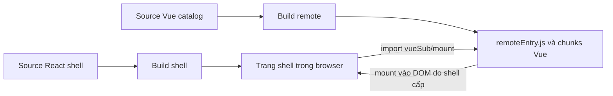
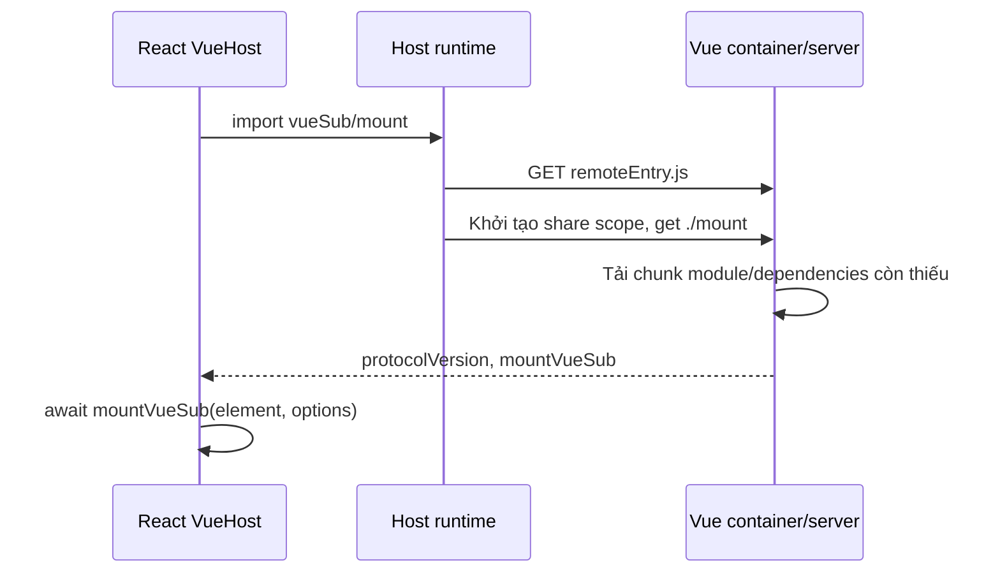

# Module Federation: microfrontend React và Vue

Bài này trả lời câu hỏi: **làm sao một trang React tải và hiển thị một ứng dụng Vue được build độc lập, mà không gộp source Vue vào build của React?**

Nếu chưa rõ entry, loader, chunk và HTML template, đọc trước [Webpack: từ source code đến trình duyệt](/web/03-webpack-tu-source-den-trinh-duyet). Ở đây chúng ta tập trung vào phần mới: **ranh giới giữa hai ứng dụng**, không học lại toàn bộ cấu hình Webpack.

<SourceRef project="module-federation-react-vue" file="shell/webpack.config.cjs" variant="button">Mở source đầy đủ · React shell + Vue remote</SourceRef>

Toàn bộ source nằm trong `examples/module-federation-react-vue/` của repository này. Bấm tên file trong bài để mở drawer; không cần một project riêng ở đường dẫn cá nhân bên ngoài repository.

## 1. Microfrontend và Module Federation khác nhau thế nào?

**Microfrontend** là cách chia frontend theo các phần có ranh giới và khả năng phát triển/deploy tương đối độc lập. **Module Federation** là cơ chế của Webpack giúp một build tải module từ build khác khi ứng dụng chạy.

Hai khái niệm không đồng nghĩa:

- Có thể làm microfrontend bằng iframe hoặc các cách tích hợp khác, không dùng Federation.
- Federation không tự chia domain, thống nhất router, cách ly CSS hay quản lý lifecycle.
- Dùng cả React và Vue ở đây để thấy rõ ranh giới tích hợp; không phải khuyến nghị mọi ứng dụng nên dùng nhiều framework.

Ví dụ có hai app:

| App | Sở hữu gì? | Dev / preview |
| --- | --- | --- |
| **React shell — host** | Trang chính, browser history, vùng DOM chứa remote | `5173` / `4173` |
| **Vue catalog — remote** | UI Catalog, Vue Router nội bộ, API mount/unmount | `5174` / `4174` |



**Host không biên dịch lại Vue.** Hai build phối hợp qua JavaScript module và một API nhỏ, không qua việc React hiểu file `.vue`.

## 2. Chạy ví dụ trước khi đọc config

Dùng Node.js **22.12+** và npm. Từ thư mục gốc repository tài liệu:

```bash
cd examples/module-federation-react-vue
npm --prefix shell install
npm --prefix vue-sub install
node scripts/dev.mjs
```

Thư mục gốc ví dụ không có `package.json`. Mỗi app có dependencies và build riêng; <SourceRef project="module-federation-react-vue" file="scripts/dev.mjs">dev.mjs</SourceRef> chỉ khởi động hai process npm, không biến chúng thành một build.

Mở `http://127.0.0.1:5173/`, rồi thử:

1. Trang Home chỉ có React.
2. Bấm **Catalog** để tải remote Vue.
3. Tăng **Remote count**, bấm **Product 42**; state của root Vue vẫn còn.
4. Thử Back/Forward và refresh `/catalog/products/42?color=blue#details`.
5. Mở `http://127.0.0.1:5174/` để xem cùng Vue app chạy standalone.

Nếu không clone repository, có thể copy các file từ drawer theo đúng đường dẫn. Chưa cần copy source của ví dụ Webpack cơ bản vào project này.

### Build và preview production output

Dừng hai dev server, hoặc dùng các cổng preview riêng:

```bash
# Vẫn ở examples/module-federation-react-vue
npm --prefix shell run build
npm --prefix vue-sub run build
node scripts/dev.mjs --preview
```

Shell preview ở `http://127.0.0.1:4173/`; remote ở `4174`. URL remote mặc định của shell được chọn theo build mode.

<SourceRef project="module-federation-react-vue" file="scripts/preview.mjs">Preview server</SourceRef> phục vụ `dist`, xử lý SPA fallback và CORS local. Đây là server minh họa để kiểm tra output, không phải cấu hình production hoàn chỉnh.

## 3. Bản đồ source: mở file nào để hiểu phần nào?

```text
module-federation-react-vue/
├── scripts/
│   ├── dev.mjs
│   └── preview.mjs
├── shell/
│   ├── package.json, tsconfig.json, index.html, webpack.config.cjs
│   └── src/
│       ├── main.tsx, bootstrap.tsx, env.d.ts, styles.css
│       ├── remote.ts
│       └── shell/App.tsx, shell/VueHost.tsx
└── vue-sub/
    ├── package.json, tsconfig.json, index.html, webpack.config.cjs
    └── src/
        ├── main.ts, bootstrap.ts, env.d.ts
        ├── mount.ts, protocol.ts, router.ts
        ├── CatalogApp.vue
        └── pages/Products.vue, pages/ProductDetails.vue
```

| Muốn hiểu gì? | Source |
| --- | --- |
| Dependencies/lệnh chạy từng app | <SourceRef project="module-federation-react-vue" file="shell/package.json">shell/package.json</SourceRef>, <SourceRef project="module-federation-react-vue" file="vue-sub/package.json">vue-sub/package.json</SourceRef> |
| Host tìm remote ở đâu? | <SourceRef project="module-federation-react-vue" file="shell/webpack.config.cjs" region="federation">remotes của shell</SourceRef> |
| Remote công khai module nào? | <SourceRef project="module-federation-react-vue" file="vue-sub/webpack.config.cjs" region="federation">exposes của Vue</SourceRef> |
| Khi nào thực sự tải Vue? | <SourceRef project="module-federation-react-vue" file="shell/src/remote.ts" region="load-remote">remote.ts</SourceRef> |
| React tạo/hủy Vue instance thế nào? | <SourceRef project="module-federation-react-vue" file="shell/src/shell/VueHost.tsx" region="mount-lifecycle">VueHost.tsx</SourceRef> và <SourceRef project="module-federation-react-vue" file="vue-sub/src/mount.ts" region="mount-api">mount.ts</SourceRef> |
| Giao diện Vue và route con | <SourceRef project="module-federation-react-vue" file="vue-sub/src/CatalogApp.vue">CatalogApp.vue</SourceRef>, <SourceRef project="module-federation-react-vue" file="vue-sub/src/router.ts">router.ts</SourceRef> |
| Standalone khác embedded ở đâu? | <SourceRef project="module-federation-react-vue" file="vue-sub/src/bootstrap.ts">bootstrap.ts</SourceRef> so với <SourceRef project="module-federation-react-vue" file="vue-sub/src/mount.ts">mount.ts</SourceRef> |

Các snippet trong bài chỉ giữ những dòng đang giải thích. Config và nội dung từng file đầy đủ nằm trong drawer.

## 4. Nối `remotes`, `exposes` và `import`

### 4.1. Shell khai báo cách tìm container

Mở <SourceRef project="module-federation-react-vue" file="shell/webpack.config.cjs" region="federation">ModuleFederationPlugin của host</SourceRef>. Phần cốt lõi:

```js
remotes: {
  vueSub: 'vueSub@http://127.0.0.1:5174/remoteEntry.js',
}
```

Config thật dùng biến `remoteUrl`, không viết cứng chuỗi development như snippet trên.

```text
vueSub: 'vueSub@http://127.0.0.1:5174/remoteEntry.js'
   │        │                       │
   │        │                       └─ URL container entry
   │        └─ tên container do remote công bố
   └─ alias mà source shell dùng khi import
```

Alias bên trái có thể đổi thành `catalog` nếu source import đổi theo. Tên container bên phải phải khớp với remote; URL chỉ ra nơi tải container đó.

### 4.2. Vue công khai mount API

Mở <SourceRef project="module-federation-react-vue" file="vue-sub/webpack.config.cjs" region="federation">ModuleFederationPlugin của remote</SourceRef>:

```js
name: 'vueSub',
filename: 'remoteEntry.js',
exposes: { './mount': './src/mount.ts' },
```

Sau đó source shell có thể gọi:

```ts
const remote = await import('vueSub/mount');
```

Đối chiếu với <SourceRef project="module-federation-react-vue" file="shell/src/remote.ts" region="load-remote">import thật trong remote.ts</SourceRef>:

```text
vueSub/mount
  │      └─ './mount' trong exposes → src/mount.ts của Vue
  └─ alias 'vueSub' trong remotes của shell
```

Browser không tải nguyên `mount.ts`. Nó tải container cùng những JavaScript chunks do project Vue đã build.

### 4.3. `remoteEntry.js` không phải toàn bộ Vue app

`remoteEntry.js` là cổng để runtime khởi tạo container và yêu cầu module công khai. Code của module và dependencies có thể nằm trong các chunk khác.



Cache có thể làm một số bước không phát sinh request mới. Sơ đồ mô tả vai trò, không cố định số request của mọi bản build.

## 5. Entry, bootstrap và thời điểm tải remote

Shell vẫn có HTML template và một JavaScript entry như bài trước:

- <SourceRef project="module-federation-react-vue" file="shell/index.html">shell/index.html</SourceRef> có DOM `root`.
- <SourceRef project="module-federation-react-vue" file="shell/src/main.tsx">main.tsx</SourceRef> dùng `import('./bootstrap')`.
- <SourceRef project="module-federation-react-vue" file="shell/src/bootstrap.tsx">bootstrap.tsx</SourceRef> tạo React root và BrowserRouter.
- <SourceRef project="module-federation-react-vue" file="shell/src/shell/App.tsx">App.tsx</SourceRef> chỉ render `VueHost` khi route thuộc `/catalog/*`.

Vì vậy có hai thời điểm khác nhau:

```text
Mở Home:
  HTML → main → bootstrap → React

Vào Catalog:
  VueHost → loadVueSub → import remote → mount Vue
```

Async bootstrap tải ngay khi entry chạy; remote chỉ được yêu cầu khi code trong `VueHost` chạy. Không đồng nhất hai ranh giới bất đồng bộ này.

<SourceRef project="module-federation-react-vue" file="shell/src/remote.ts">Remote loader</SourceRef> dùng chung Promise tải module cho những lời gọi đồng thời, kiểm tra protocol và xóa Promise lỗi để không tự giữ một kết quả reject mãi. Cơ chế cache bên trong runtime Federation vẫn tồn tại; reload trang là cách retry đơn giản trong ví dụ này.

<SourceRef project="module-federation-react-vue" file="shell/src/env.d.ts">env.d.ts của shell</SourceRef> mô tả module `vueSub/mount` cho TypeScript. **Khai báo type không tự tạo remote và không thay kiểm tra runtime.**

## 6. Mount contract: lấy module chưa có nghĩa là có giao diện

`import()` trả về exports. Shell phải gọi một API rõ ràng để tạo Vue instance:

```ts
export const protocolVersion = 1;

// Hình dạng API; xem source đầy đủ trong drawer.
mountVueSub(element, { initialLocation, onNavigate });
```

Trong ví dụ, `mountVueSub` là hàm async và trả về Promise chứa hai thao tác:

| Thao tác | Trách nhiệm |
| --- | --- |
| `updateLocation(location)` | Đồng bộ location của shell vào router nội bộ Vue |
| `unmount()` | Gỡ navigation hook và Vue instance khi host không còn cần |

Mở <SourceRef project="module-federation-react-vue" file="vue-sub/src/protocol.ts">protocol.ts</SourceRef> và <SourceRef project="module-federation-react-vue" file="vue-sub/src/mount.ts" region="mount-api">mount API hoàn chỉnh</SourceRef>. Remote chuẩn bị memory router, chờ route ban đầu sẵn sàng rồi mới mount.

**Ranh giới DOM:** React sở hữu container; Vue sở hữu các node con mà nó tạo trong container. Không để cả React và Vue cùng render lại các node con đó.

### Cleanup khi component host biến mất

Trong <SourceRef project="module-federation-react-vue" file="shell/src/shell/VueHost.tsx" region="mount-lifecycle">effect quản lý lifecycle</SourceRef>, chú ý:

1. Nếu đã rời route trong khi import chưa xong, không bắt đầu mount.
2. Nếu mount async hoàn tất sau khi host đã bị hủy, gọi `unmount()` ngay.
3. Khi rời Catalog, cleanup hủy instance và xóa ref.
4. `unmount()` của remote có thể gọi lặp mà không phá trạng thái đã hủy.

Không chỉ tải module rồi bỏ mặc cleanup. Chuyển route nhiều lần mà không unmount có thể để lại subscriptions, hooks hoặc DOM/state không mong muốn.

### Remote không sẵn sàng thì shell vẫn phải dùng được

`VueHost` hiển thị loading và lỗi trong vùng Catalog, kèm nút reload. Navigation Home vẫn thuộc React. Host kiểm tra `protocolVersion` và `mountVueSub` trước khi gọi, nhưng đây chưa phải hệ thống xác thực hay kiểm tra schema API đầy đủ.

Protocol là contract của ứng dụng, không phải version của Webpack. Khi deploy remote mới, phải cân nhắc host cũ đang mở trong browser.

## 7. Navigation bridge: chỉ một bên sở hữu browser history

Module Federation không tự đồng bộ React Router với Vue Router. Ví dụ chọn:

- Shell dùng **BrowserRouter**, sở hữu URL trên thanh địa chỉ.
- Vue embedded dùng **createMemoryHistory()**; không tự ghi browser history.
- Vue standalone dùng **createWebHistory()** vì khi đó không có shell điều phối.

Đối chiếu <SourceRef project="module-federation-react-vue" file="shell/src/bootstrap.tsx">router shell</SourceRef>, <SourceRef project="module-federation-react-vue" file="vue-sub/src/mount.ts">router embedded</SourceRef> và <SourceRef project="module-federation-react-vue" file="vue-sub/src/bootstrap.ts">router standalone</SourceRef>.

### Shell → Vue

<SourceRef project="module-federation-react-vue" file="shell/src/shell/VueHost.tsx" region="location-bridge">Location effect</SourceRef> truyền **pathname + search + hash** vào `updateLocation`. Điều này cần cả khi người dùng bấm Back/Forward hoặc mở trực tiếp deep link, không chỉ khi click trong React.

### Vue → shell

Vue Router báo navigation qua `onNavigate`. Shell dùng React Router `navigate()` để cập nhật URL; location mới lại đi xuống Vue.

Để tránh vòng lặp:

- Không replace route nếu full path đã khớp.
- Không phát `onNavigate` ngược lên cho update đang do host thực hiện.
- Bỏ qua navigation bị router hủy/lỗi và gỡ hook khi unmount.
- Chỉ nhận URL thuộc namespace `/catalog`; không nhận URL ngoài app hoặc URL có backslash.

Xem cả hai chiều trong <SourceRef project="module-federation-react-vue" file="vue-sub/src/mount.ts" region="mount-api">mount.ts</SourceRef> và <SourceRef project="module-federation-react-vue" file="shell/src/shell/VueHost.tsx" region="mount-lifecycle">VueHost.tsx</SourceRef>.

Bấm **Remote count** rồi đổi route con để kiểm tra: root Vue không bị mount lại mỗi lần pathname đổi. Rời hẳn Catalog mới unmount; quay lại tạo instance mới.

## 8. Config nào chỉ phục vụ build React/Vue?

Federation không thay thế loaders. Mỗi app vẫn phải build source của chính nó.

| App | Cấu hình cần đọc |
| --- | --- |
| React shell | <SourceRef project="module-federation-react-vue" file="shell/webpack.config.cjs" region="loaders">TS/TSX và CSS rules</SourceRef>, <SourceRef project="module-federation-react-vue" file="shell/tsconfig.json">tsconfig React</SourceRef> |
| Vue remote | <SourceRef project="module-federation-react-vue" file="vue-sub/webpack.config.cjs" region="loaders">Vue/TS/CSS rules</SourceRef>, <SourceRef project="module-federation-react-vue" file="vue-sub/tsconfig.json">tsconfig Vue</SourceRef> |
| Vue SFC thật | <SourceRef project="module-federation-react-vue" file="vue-sub/src/CatalogApp.vue">CatalogApp.vue</SourceRef>, <SourceRef project="module-federation-react-vue" file="vue-sub/src/pages/ProductDetails.vue">ProductDetails.vue</SourceRef> |

Ở Vue:

- `vue-loader` tách template/script/style; `VueLoaderPlugin` phối hợp với các rules khác.
- `appendTsSuffixTo: [/\.vue$/]` giúp phần TypeScript trong SFC đi qua ts-loader; không đổi tên file trên đĩa.
- Alias `vue$` chọn bản runtime-only; template SFC đã compile lúc build.
- CSS đi qua css-loader rồi style-loader. `<style scoped>` giới hạn selector của component, không tạo một security sandbox.

Hai config dùng `transpileOnly: true`, nên có lệnh type-check riêng: shell chạy `tsc --noEmit`, Vue chạy `vue-tsc --noEmit`. Script build chạy check trước; dev không tự có full type-check riêng.

`tsconfig` đặt `noEmit: true` cho type checker. Rule ts-loader ghi đè `noEmit: false` để nhận JavaScript chuyển cho Webpack; không cần sinh `App.js` cạnh source.

## 9. Public path, tên runtime và output

Mở <SourceRef project="module-federation-react-vue" file="shell/webpack.config.cjs" region="output">output shell</SourceRef> và <SourceRef project="module-federation-react-vue" file="vue-sub/webpack.config.cjs" region="output">output Vue</SourceRef> để so sánh.

### Remote phải tải chunk từ server remote

Giả sử trang hiện tại ở shell `5173`, nhưng container được tải từ:

```text
http://127.0.0.1:5174/remoteEntry.js
```

`output.publicPath: 'auto'` giúp runtime remote suy ra nơi lấy những chunks tiếp theo. Chunk Vue không nên bị yêu cầu từ `5173` chỉ vì nó render vào DOM của shell.

Phân biệt:

| Cấu hình | Nhiệm vụ |
| --- | --- |
| `output.path` | Thư mục ghi file trên máy build |
| `HtmlWebpackPlugin.publicPath: '/'` | URL gốc của script/link được chèn trong HTML |
| `output.publicPath: 'auto'` | Base URL cho chunk/asset mà runtime tải sau đó |
| Server SPA fallback | Trả HTML khi mở trực tiếp route ứng dụng phù hợp |

Deploy dưới `/demo/` cần đồng bộ public paths và router base; `'/'` không tự chuyển thành `/demo/`.

### `uniqueName` không phải tên container

| Tên | Vai trò |
| --- | --- |
| Alias `vueSub` trong `remotes` | Tiền tố source import của host |
| Container `name: 'vueSub'` | Định danh container remote mà host cần tìm |
| `uniqueName: 'routingVueSub'` | Phân biệt runtime/chunk-loading globals của build Vue |

Shell dùng `routingReactShell`; remote dùng `routingVueSub`. Hai build chạy trên cùng trang nên không được vô tình dùng chung định danh chunk runtime.

### Output nhìn từ browser

Dạng output minh họa, không phải danh sách tên cố định cho mọi lần build:

```text
shell/dist/                  vue-sub/dist/
├── index.html               ├── index.html
├── main.<hash>.js           ├── main.<hash>.js
└── <chunks>.<hash>.js       ├── remoteEntry.js
                            └── <chunks>.<hash>.js
```

HTML shell không phải chèn mọi chunk Vue. HTML standalone của Vue có thể chứa cả entry ứng dụng và container entry, tùy lựa chọn entrypoints của HtmlWebpackPlugin. Shell không tải HTML standalone đó để tích hợp.

`output.filename` đặt tên initial chunks; `ModuleFederationPlugin.filename` chủ động đặt `remoteEntry.js` cố định. Chunk ID số không đồng nghĩa với source file số hoặc một vai trò cố định.

Muốn xem runtime/chunk output dễ đọc trước, dùng các [build capture ở bài Webpack cơ bản](/web/03-webpack-tu-source-den-trinh-duyet#81-so-sánh-output-trước-và-sau-khi-tách-bootstrap). Chúng minh họa Webpack runtime, không phải artifacts của project Federation này.

## 10. Shared dependencies và async bootstrap

Mở <SourceRef project="module-federation-react-vue" file="vue-sub/webpack.config.cjs" region="federation">shared của Vue remote</SourceRef>:

```js
vue: { singleton: true, requiredVersion: pkg.dependencies.vue },
'vue-router': { singleton: true, requiredVersion: pkg.dependencies['vue-router'] },
```

- `shared` đăng ký việc cung cấp/tiêu thụ package qua share scope.
- `singleton: true` yêu cầu chọn một phiên bản cho package đó trong scope liên quan, không đảm bảo mọi app ở mọi runtime đều dùng chung một instance.
- `requiredVersion` khai báo khoảng version mong muốn. Xung đột version vẫn cần được kiểm tra và quản lý.

Shell chỉ dùng React, nên không khai báo shared Vue ở shell. Shared React cũng không giúp chia sẻ Vue; đó là hai dependency khác nhau.

Vue entry dùng <SourceRef project="module-federation-react-vue" file="vue-sub/src/main.ts">async bootstrap</SourceRef> để runtime có ranh giới chuẩn bị các shared modules trước khi code tiêu thụ chúng. Bỏ ranh giới có thể gặp lỗi `Shared module is not available for eager consumption`, tùy graph và cấu hình.

Không suy ra mọi React app đều bắt buộc có bootstrap riêng: [bản React cơ bản](/web/03-webpack-tu-source-den-trinh-duyet) chạy được mà chưa cần bước đó.

## 11. Build-time URL, CORS và cache

### Biến môi trường được đọc khi build

<SourceRef project="module-federation-react-vue" file="shell/webpack.config.cjs">Shell config</SourceRef> đọc `process.env.VUE_SUB_URL`; <SourceRef project="module-federation-react-vue" file="shell/webpack.config.cjs" region="constants">DefinePlugin</SourceRef> đưa URL vào code ứng dụng để hiển thị/tham chiếu.

```bash
# Chạy ở examples/module-federation-react-vue
VUE_SUB_URL=https://cdn.example.com/catalog/remoteEntry.js \
  npm --prefix shell run build
```

Đổi biến môi trường trên server sau khi build không tự sửa bundle cũ. Ví dụ không tự nạp `.env`; chỉ tạo một file `.env` chưa đủ. Không nhúng secrets vào DefinePlugin vì bundle browser là tài nguyên công khai.

Muốn đổi URL remote mà không rebuild host cần thiết kế runtime configuration riêng; đó không phải khả năng tự có từ cấu hình hiện tại.

### Hai phía CORS phải phù hợp

<SourceRef project="module-federation-react-vue" file="vue-sub/webpack.config.cjs" region="dev-server">Vue dev server</SourceRef> cho phép một số shell origins qua header. <SourceRef project="module-federation-react-vue" file="scripts/preview.mjs">Preview server</SourceRef> có allowlist tương ứng cho các cổng preview.

`crossOriginLoading: 'anonymous'` cấu hình thuộc tính cross-origin khi runtime tải script; **không tự tạo CORS headers ở remote server**. `localhost` và `127.0.0.1`, hoặc hai port khác nhau, là các origin khác nhau.

Xem [CORS](/web/01-cors) để phân biệt quy tắc tải tài nguyên. Remote script chạy cùng trang vẫn có quyền truy cập DOM; CORS không biến remote thành sandbox và không thay authentication/authorization.

### File có hash và `remoteEntry.js` không nên cache giống nhau

- Hashed chunks có thể cache lâu với policy phù hợp.
- HTML và `remoteEntry.js` tên cố định cần revalidate/cache cẩn thận để không trỏ tới một tập chunks sai phiên bản.
- Giữ các hashed assets cũ đủ lâu cho tab đang mở; `output.clean` local không phải chiến lược rolling deployment.
- Preview script dùng `no-store` để dễ kiểm tra local, không mô phỏng toàn bộ CDN cache production.

`devServer` không tự trở thành cấu hình Nginx/CDN. Production cần cấu hình riêng cho asset URLs, fallback, CORS, cache và CSP.

## 12. Lần theo request và thử các tình huống

### Mở Home rồi vào Catalog

Trong DevTools → Network, bật Disable cache:

1. Mở shell Home: có HTML, main và các chunk React; chưa cần `remoteEntry.js`.
2. Bấm Catalog: xuất hiện remote entry từ server Vue và các chunk cần cho mount.
3. Xem Initiator: HTML tải entry shell; runtime JavaScript yêu cầu phần còn thiếu.
4. Kiểm tra chunk Vue tiếp tục tải từ server Vue, không bị chuyển sang origin shell.

Ở development còn có request hỗ trợ dev server. Dùng production preview để quan sát output mà ít nhiễu hơn.

### Refresh deep link

Mở thẳng `/catalog/products/42?color=blue#details`:

1. Shell server trả HTML qua SPA fallback.
2. HTML tải entry từ URL đúng, không gắn nhầm dưới `/catalog/products/`.
3. React Router render `VueHost` theo location hiện tại.
4. Host tải remote và truyền full location vào memory router Vue.
5. Remote hiển thị Product 42, query `color=blue` và hash `#details`.

Thiếu một trong các đoạn trên đều có thể làm refresh thất bại; không có một tùy chọn Federation duy nhất làm toàn bộ công việc.

### Xem output và stats trên máy

```bash
# Sau khi build cả hai app, từ thư mục ví dụ
ls shell/dist
ls vue-sub/dist
cat shell/dist/index.html
cat vue-sub/dist/index.html

# Build trực tiếp để xuất stats; không tự chạy bước check của npm run build.
cd shell
npx webpack --config webpack.config.cjs --mode production \
  --profile --json /tmp/federation-shell-stats.json
```

Trong stats, đọc chunk ID, `files`, `initial`, modules và remote dependencies. Đừng gán cố định một ID số cho React hoặc Vue.

Để kiểm tra tự động toàn bộ ví dụ, từ **root repository tài liệu**:

```bash
npx playwright install chromium
npm run examples:federation:test
```

Lệnh này cài/build source trong thư mục tạm, mở preview ở cổng trống và kiểm tra load lười, mount/unmount, navigation, Back/Forward, deep refresh, standalone và remote không sẵn sàng. Nó không cần dừng dev server đang mở.

## 13. Bảng debug theo triệu chứng

| Hiện tượng | Đọc/kiểm tra trước |
| --- | --- |
| `vueSub/mount` không resolve khi build | Alias trong host `remotes`, spelling của import và `env.d.ts` |
| `remoteEntry.js` 404 | URL mà shell đã build vào, remote server và đường dẫn deploy |
| Remote entry tải được nhưng module không tồn tại | Container name, key `./mount` trong `exposes` |
| Lỗi eager consumption | Async boundary, shared config và thời điểm dùng dependency |
| Entry tải được nhưng chunk remote 404 | Remote `publicPath`, vị trí deploy chunks và cache của remote entry |
| Request `.js` nhận HTML | Asset URL sai hoặc server fallback quá rộng |
| Lỗi CORS ở browser | Origin thực tế, allowlist và header của server remote |
| Import thành công nhưng không có UI | Host đã gọi/await mount chưa, root element, protocol và lỗi router |
| Đổi route làm state Vue reset | Có remount root theo mỗi location thay vì gọi `updateLocation` không? |
| Back/Forward hoặc query/hash lệch | Bridge có truyền full path và chỉ một bên giữ browser history không? |
| Rời Catalog nhưng hooks/state còn chạy | Effect cleanup và `unmount` của remote |
| Deploy remote mới làm host cũ hỏng | Protocol/API compatibility, version selection và asset retention |
| Sửa `VUE_SUB_URL` mà URL cũ vẫn xuất hiện | Biến được đọc lúc build; cần rebuild host với cấu hình hiện tại |

## 14. Ranh giới cần giữ khi áp dụng vào dự án thật

- Chia theo capability/domain và quyền sở hữu của đội, không chỉ chia theo framework.
- Giữ mount contract nhỏ, có version, xử lý lỗi và cleanup rõ ràng.
- Không dùng singleton như lời hứa tự giải quyết mọi xung đột dependencies.
- Xác định bên sở hữu URL, trạng thái dùng chung và chiến lược cách ly CSS.
- Chỉ tải remote tin cậy; nếu cần cách ly mạnh, cân nhắc iframe hoặc ranh giới khác.
- Có kế hoạch quan sát lỗi tải remote, rollback, cache và giữ assets cũ.

**Module Federation phân phối module giữa các build. Microfrontend vận hành được hay không còn phụ thuộc contract, lifecycle, navigation và deployment của ứng dụng.**

## Tài liệu tham khảo

- [Webpack cơ bản và output thực tế](/web/03-webpack-tu-source-den-trinh-duyet) — nền tảng entry, loaders, chunks và runtime.
- [Frontend build tooling](/web/02-frontend-build-tooling) — phân biệt compiler, bundler và type checker.
- [CORS](/web/01-cors) — origin và cách kiểm tra response headers.
- [Webpack Module Federation](https://webpack.js.org/concepts/module-federation/) — container, shared modules và async bootstrap.
- [ModuleFederationPlugin](https://webpack.js.org/plugins/module-federation-plugin/) — `remotes`, `exposes`, `shared`, version requirements.
- [Webpack Public Path](https://webpack.js.org/guides/public-path/) — base URL của chunk/asset.
- [Vue Loader](https://vue-loader.vuejs.org/guide/) — Vue SFC với Webpack.
- [Vue Router history modes](https://router.vuejs.org/guide/essentials/history-mode.html) — web history và memory history.
